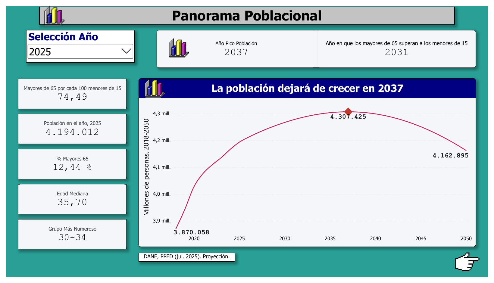
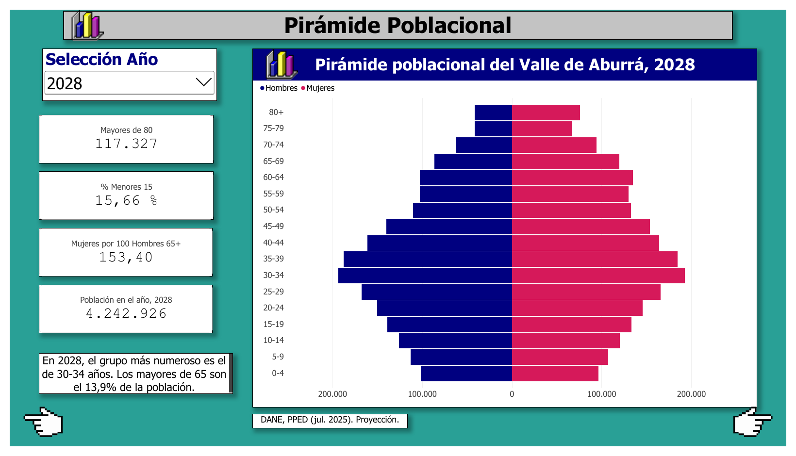
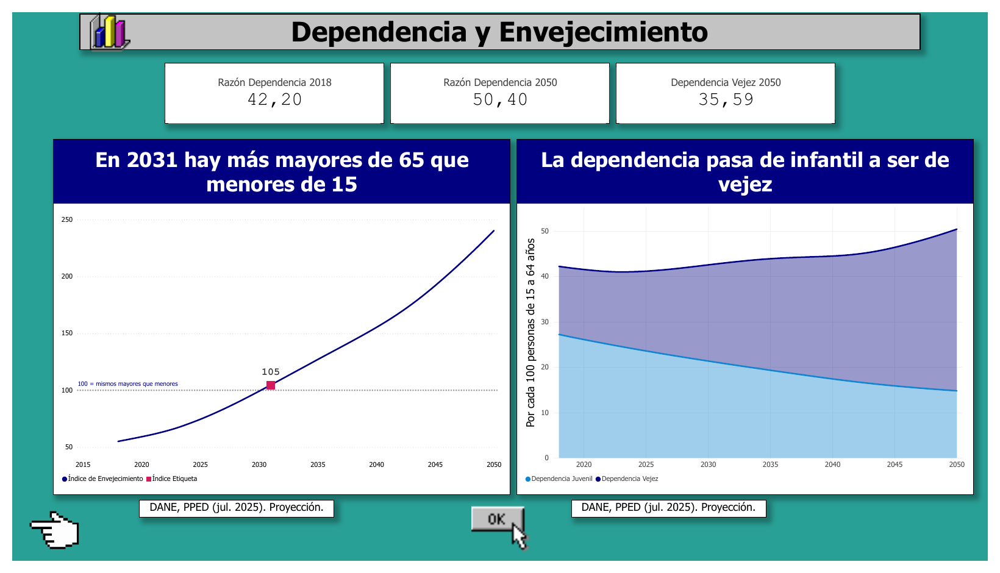

# El Valle de Aburrá envejece: ¿qué pasará con su población hasta 2050?

Análisis de las proyecciones oficiales de población del DANE para la región demográfica **Valle de Aburrá** (2018-2050), con **Python (Jupyter), MySQL y Power BI**.

**Tecnologías:** Python (pandas, SQLAlchemy, matplotlib) · MySQL 8 (CTEs y funciones de ventana) · Power BI (DAX) · Jupyter en VS Code.

## Pregunta
¿Cómo cambiará la estructura por edad y sexo del Valle de Aburrá hasta 2050, y qué implica el envejecimiento para la población en edad de trabajar?

## Hallazgos clave

| Indicador | 2018 | 2025 | 2035 | 2050 |
|---|---|---|---|---|
| Población total | 3,87 M | 4,19 M | 4,30 M | 4,16 M |
| % menores de 15 | 19,1 % | 16,7 % | 13,4 % | 9,8 % |
| % mayores de 65 | 10,5 % | 12,4 % | 17,1 % | 23,7 % |
| % mayores de 80 | 2,4 % | 2,5 % | 3,9 % | 7,5 % |
| Edad mediana (años) | 33,1 | 35,7 | 41,0 | 49,2 |
| Índice de envejecimiento* | 55 | 74,5 | 127 | 240 |
| Razón de dependencia total** | 42,2 | 41,1 | 43,9 | 50,4 |

\* Mayores de 65 por cada 100 menores de 15. \*\* (menores de 15 + mayores de 65) por cada 100 personas de 15 a 64.

1. **La población deja de crecer en 2037** (pico de 4,31 M) y desde 2038 decrece.
2. **En 2031 los mayores de 65 superan a los menores de 15** (656 mil frente a 627 mil).
3. **La población de 80+ se triplica** entre 2025 y 2050 (de 104 mil a 313 mil), el grupo que más crece en términos absolutos.
4. **Todos los grupos menores de 45 años pierden población** entre 2025 y 2050: los de 0 a 39 años caen entre 21 % y 42 %, y el de 40 a 44 apenas un 4 %.
5. **La dependencia cambia de naturaleza**: en 2018 era sobre todo infantil; hacia 2050 la dependencia de vejez (35,6) es más del doble que la juvenil (14,8).
6. **La vejez sigue siendo mayoritariamente femenina**, aunque la brecha se estrecha: mujeres por cada 100 hombres de 80+ pasan de 174 (2018) a 168 (2050).
7. **Cabecera y zona rural envejecen casi en paralelo** (hasta 2045), con la zona rural un poco más joven.

## Dashboard

Tres páginas en Power BI, con una estética retro de Windows 95 (tema propio en `dashboard/windows96_theme.json`). Versión navegable: [`dashboard/dashboard_valle_aburra.pdf`](dashboard/dashboard_valle_aburra.pdf).

**1. Panorama poblacional:** población total 2018-2050, hitos (pico en 2037, cruce en 2031) e indicadores del año seleccionado.



**2. Pirámide poblacional:** pirámide por sexo y grupo de edad, con selector de año.



**3. Dependencia y envejecimiento:** índice de envejecimiento y razón de dependencia juvenil frente a la de vejez.



Para abrir el `.pbix` necesitas Power BI Desktop (solo Windows). Los datos están importados dentro del archivo, así que puedes explorarlo sin tener MySQL; para actualizarlo desde la base debes instalar MySQL Connector/NET y tener la base `vda_envejecimiento` cargada (ver "Cómo reproducirlo").

## Estructura
```
01_esquema_mysql.sql        # Base y tablas en MySQL
02_analisis.ipynb           # Notebook: carga, limpieza, indicadores, MySQL, SQL, gráficas
03_consultas_mysql.sql      # 8 consultas (CTEs, LAG, RANK, pivotes)
data/raw/                   # Aquí va el Excel del DANE (no se sube al repositorio)
.env.example                # Plantilla de credenciales (copiar como .env)
data/                       # CSV generados
dashboard/
  valle_aburra_envejecimiento.pbix   # Dashboard de Power BI
  dashboard_valle_aburra.pdf         # Exportación en PDF
  windows96_theme.json               # Tema de Power BI
  img/                               # Gráficas del notebook y capturas del dashboard
```

## Cómo reproducirlo
1. Descarga el archivo **PPED-AreaSexoEdadReg-2018-2050.xlsx** del DANE y guárdalo en `data/raw/`.
2. Instala las dependencias: `pip install -r requirements.txt`
3. Crea tu archivo de credenciales: copia `.env.example` como `.env` y escribe tu contraseña de MySQL. El archivo `.env` está en `.gitignore`, así que no se sube al repositorio.
4. Abre `02_analisis.ipynb` en VS Code, elige el kernel de Python y ejecuta todas las celdas. El notebook crea la base `vda_envejecimiento` y carga las tablas.

Requiere **MySQL 8.0 o superior** (CTEs y funciones de ventana). Probado en MySQL 8.4.

## Metodología
1. **Extracción:** hoja `PobRegionalxÁreaSexoEdad` del archivo PPED del DANE, filtrando la región `VDA`.
2. **Transformación:** paso de formato ancho (310 columnas) a una fila por año, área, sexo y edad simple (17.978 filas).
3. **Validación:** la suma de edades coincide con el total oficial del DANE en las 89 combinaciones año/área.
4. **Indicadores:** grupos de edad, índice de envejecimiento, razones de dependencia, edad mediana (interpolada) y razón de feminidad.
5. **Carga a MySQL** con SQLAlchemy y análisis con SQL.
6. **Visualización** en Power BI, conectado a MySQL (también puede usarse con los CSV de `data/`).

## Limitaciones
- **Es una proyección, no una observación.** Depende de supuestos de fecundidad, mortalidad y migración del DANE; la incertidumbre crece con el horizonte.
- **El desglose cabecera / rural solo llega hasta 2045**; el total llega hasta 2050.
- **La región demográfica "Valle de Aburrá" es una agrupación del DANE.** Para cifras por municipio habría que usar la serie municipal.
- El análisis es descriptivo: no modela causas (migración, políticas, cambios económicos).

## Fuentes
- DANE, *Proyecciones de población y estudios demográficos (PPED)*, actualización del 30 de julio de 2025.

---

## Autor y contacto

**Juan Andrés Valdés** · Data Analyst

- LinkedIn: [juan-valdes-data](https://www.linkedin.com/in/juan-valdes-data/)

¿Comentarios o sugerencias sobre el proyecto? Escríbeme.
